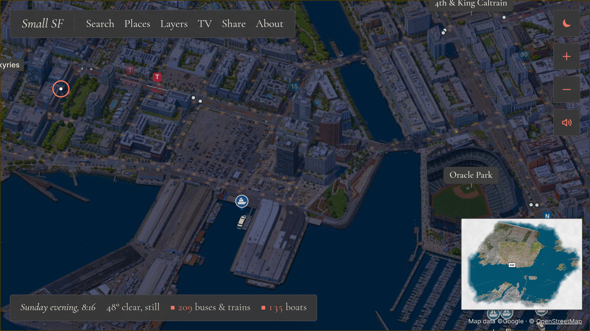
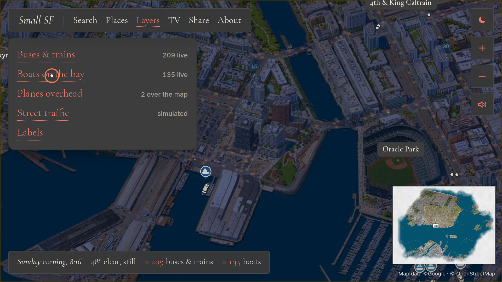

# Small SF TV

**Put [Small SF](https://smallsf.com/) — the illustrated, live map of San Francisco — on your TV.**

A tiny Fire TV / Android TV app (29 KB) that opens smallsf.com fullscreen, keeps the screen awake, and makes the whole site usable from the couch with just the remote: a D-pad cursor for the site's own controls, one-button zoom, a Layers shortcut, and drag-to-pan.



*Live on a Fire TV Cube: evening lighting, real Muni, boats on the Bay — 209 buses & trains, 135 boats at capture time.*



*The Layers panel, opened with the remote's Menu button, cursor parked on “Boats on the bay.”*

## Why

Small SF is a hand-illustrated isometric map of San Francisco with live data layered on top: Muni buses and trains from 511.org, boats from AIS, planes from ADS-B, simulated street traffic, and fog and lighting that follow the real sky. It's mesmerising on a big screen — but TVs don't have mice, and the site's controls (Layers, Places, zoom) are built for pointers. This app bridges that gap.

> Not affiliated with smallsf.com. The map, artwork and live data are the work of [Ari Dutilh](https://smallsf.com/about); this project is only a TV-friendly wrapper around the public website. If you enjoy it, the credit — and any support — belongs there.

## Install

**Option 1 — Downloader (easiest on Fire TV):**
1. Install the free *Downloader* app from the Amazon Appstore.
2. Open this repo's [latest release](https://github.com/barkleesanders/smallsf-tv/releases/latest) on your phone, copy the `SmallSF-TV.apk` link, and enter it in Downloader. (Or use a release short link of your own.)
3. Allow Downloader to install unknown apps when prompted, then install.

**Option 2 — ADB:**
```bash
adb connect <fire-tv-ip>:5555
adb install SmallSF-TV.apk
adb shell am start -n com.barklee.smallsftv/.MainActivity
```

The app appears in the Fire TV app row as **Small SF**. It also installs on Android TV / Google TV devices (min Android 7 / API 24).

## Remote controls

| Button | What it does |
|---|---|
| **D-pad** | Move the cursor (hold to accelerate; it hides itself after 5 s) |
| **OK** | Tap at the cursor — works on Layers, Places, Search, zoom buttons, everything |
| **OK + D-pad** | Hold OK and move to drag / pan the map |
| **Fast-forward** | Zoom in |
| **Rewind** | Zoom out |
| **Menu** | Open/close the **Layers** panel (cursor jumps to it) |
| **Play/Pause** | Reload the page |
| **Back** | First press closes any open panel; press again to exit |

The app also reloads itself every 6 hours to keep the live data fresh, and retries automatically after a network drop.

## Choosing your view

The default view is Mission Rock / Mission Bay (`?at=37.77530,-122.38860,1200m`). Any Small SF share link works — frame a view on the website, click **Share**, and launch the app with that URL, no rebuild needed:

```bash
adb shell am start -n com.barklee.smallsftv/.MainActivity \
  -e url "https://smallsf.com/?at=37.79530,-122.39360,400m"
```

To change the permanent default, edit `DEFAULT_URL` in `MainActivity.java` and rebuild. The site's departures-board mode works too: `-e url "https://smallsf.com/?tv=<muni-stop-id>&m=600"`.

## Build

No Gradle — the build is a small shell script driving the Android SDK tools directly (`aapt2` → `javac` → `d8` → `zipalign` → `apksigner`):

```bash
# Needs: a JDK, Android SDK platform android-30, build-tools 35.0.0
./build-on-mini.sh   # (named for the Mac mini it was written on; runs anywhere)
```

Signing uses a local `signing.keystore` (generated on first build, git-ignored). Rebuilds signed with the same key install over the top of previous versions.

## How it works

One `Activity`, one fullscreen `WebView`, one cursor `View` — about 300 lines of Java, no dependencies.

The interesting problem was keys: a WebView happily swallows D-pad presses for its own focus navigation, so the app intercepts every remote key in `dispatchKeyEvent` (which runs *before* the WebView) and translates them itself — D-pad moves an overlay cursor, OK synthesizes touch events at the cursor (down/move/up, so holding OK drags the map), and zoom calls the site's own camera (`window.__cam.zoomStep`, the same call its zoom buttons make). Layers is a JS click on the site's Layers button, after which the cursor is parked on the panel using the button's real on-screen coordinates.

## License

MIT for the app code (see `LICENSE`). The Small SF website, artwork and data are © their respective creators and are not covered by this license.
